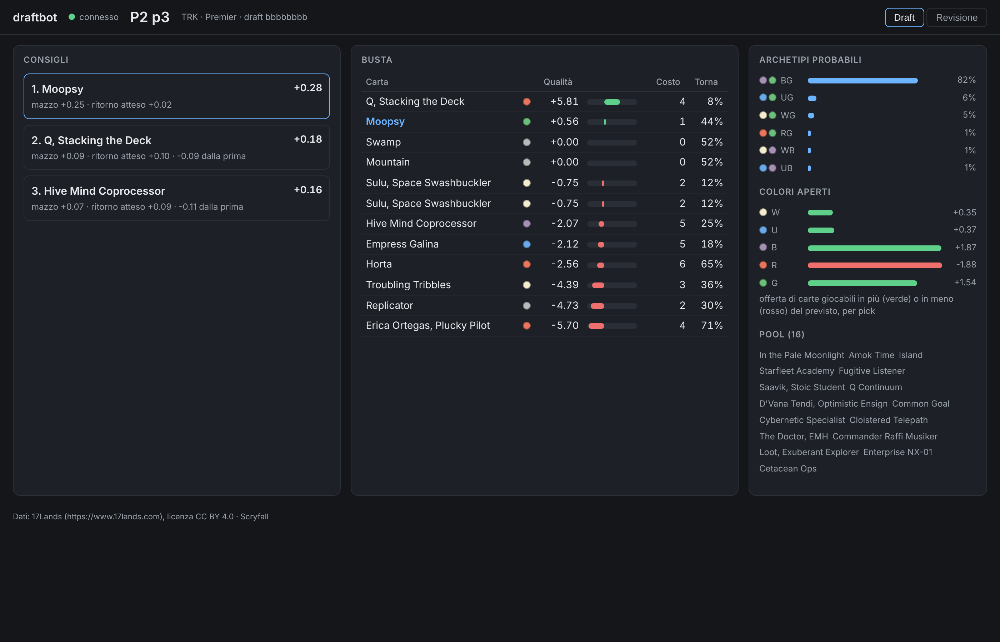

# MTGA-draft-support

Assistente locale (Python 3.11+) per i draft di MTG Arena, nei formati **Premier Draft** e **Pick Two
Draft**. Legge `Player.log` in sola lettura, suggerisce i pick spiegando il punteggio e propone 2-3
mazzi a fine draft. Interfaccia web locale o riga di comando.

**Guida d'uso: [`docs/guida.md`](docs/guida.md).**

## In breve

```bash
pip install -e .[ui]
python -m draftbot add-set TRK && python -m draftbot update-data TRK   # dati del set
python -m draftbot ui                                                  # http://127.0.0.1:8765
```

In Arena va attivato *Opzioni > Account > "Detailed Logs (Plugin Support)"*.



## Come decide

- **Qualità delle carte**: win rate in mano (GIH WR) calcolata dai dataset pubblici 17Lands, con un
  blend bayesiano verso un prior. Il prior viene da come i giocatori scelgono le carte, stimato sui
  set precedenti, quindi funziona anche prima dei game data.
- **Valore di un pick**: quanto migliora la win rate attesa del mazzo finale. Il mazzo è proiettato
  con le carte future attese e mediato sulle coppie di colori probabili. In Pick Two si valutano le
  coppie. Si aggiunge il valore atteso di ciò che tornerà al giro dopo (wheel).
- **Mazzo finale**: 2-3 build con un valutatore di mazzo stimato sui dati (qualità, curva, colori,
  splash), con terre e basi.

Tutto è verificato sui dati 17Lands di FRA senza usare dati futuri (stima fino a una data, verifica
dopo):
- **pick**: d'accordo con la scelta dei giocatori forti nel 51% dei pick Premier, contro il 46%
  della scelta media dei giocatori (ATA);
- **valutatore di mazzo**: pendenza 0,93–0,98 fuori campione (ideale 1).

Cosa **non** funziona ancora bene è scritto nei report:
- impegno sui colori troppo precoce;
- sinergie e segnali misurati ma senza beneficio, quindi esclusi dal punteggio;
- splash raro.

## Stato

| Fase | Contenuto | Report |
|---|---|---|
| 0 | Verifiche, scheletro | [phase0](docs/phase0_report.md) |
| 1 | Database carte, ID Arena, `add-set` | [phase1](docs/phase1_report.md) |
| 2 | Parser di Player.log, pulizia dei log | [phase2](docs/phase2_report.md) — **da verificare su log reali** |
| 3 | Statistiche 17Lands, blend bayesiano, prior | [phase3](docs/phase3_report.md) |
| 4 | Valutatore di mazzo, pick, backtest | [phase4](docs/phase4_report.md) |
| 5 | Sinergie | [phase5](docs/phase5_report.md) |
| 6 | Costruzione del mazzo | [phase6](docs/phase6_report.md) |
| 7 | Wheel, segnali, lettura live | [phase7](docs/phase7_report.md) |
| 8 | UI web, revisione post-draft | [phase8](docs/phase8_report.md) |
| 9 | Generalità, rifinitura, documentazione | [phase9](docs/phase9_report.md) |

Piano: [`docs/plan.md`](docs/plan.md).

## Struttura

- `draftbot/`: motore, indipendente dal set (un test lo verifica):
  - `arenalog/`: parser di Player.log, pulizia dei dati personali, log sintetici per i test;
  - `stats/`: aggregazione dei dati 17Lands, metriche, blend bayesiano, prior, calibrazione;
  - `engine/`: valutatore di mazzo, proiezione, archetipi, pick, wheel, segnali, build, backtest,
    revisione;
  - `synergy/`: tag dei temi e misura delle sinergie;
  - `ui/`: server FastAPI + WebSocket e pagina web; `live.py`: lettura live del log.
- `sets/<CODICE>.yaml`: config del set; `sets/<CODICE>.tags.yaml`: tag dei temi (da rivedere a mano).
- `formats/<nome>.yaml`: struttura del formato (tavolo, carte per pick, buste, passaggio).
- `priors/`: modelli stimati (prior, valutatore di mazzo, wheel, sinergie per set), rigenerabili.
- `tags/themes.yaml`: regole generiche dei temi di sinergia.
- `docs/`: piano, report delle fasi, guida, output delle verifiche (`docs/backtest/`).

## Test

```bash
pip install -e .[dev]
python -m pytest
```

I test sono offline e usano una cartella dati temporanea.

## Dati e condizioni d'uso

- Dati di gioco: [17Lands](https://www.17lands.com), dataset pubblici con licenza CC BY 4.0. Non si
  usano le API riservate al sito.
- Dati delle carte: [Scryfall](https://scryfall.com).
- Il tool legge solo il log di Arena: non automatizza click e non modifica il client. Wizards non
  ha preso una posizione esplicita sui tool di supporto al draft: usalo consapevolmente.
