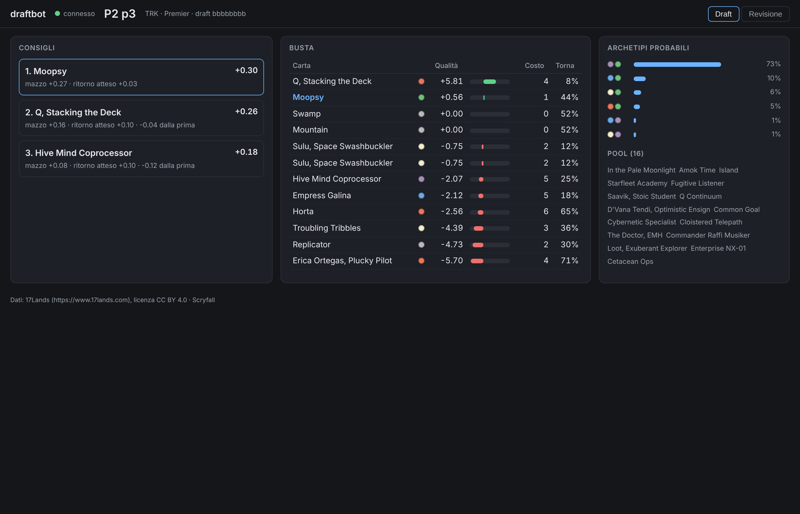
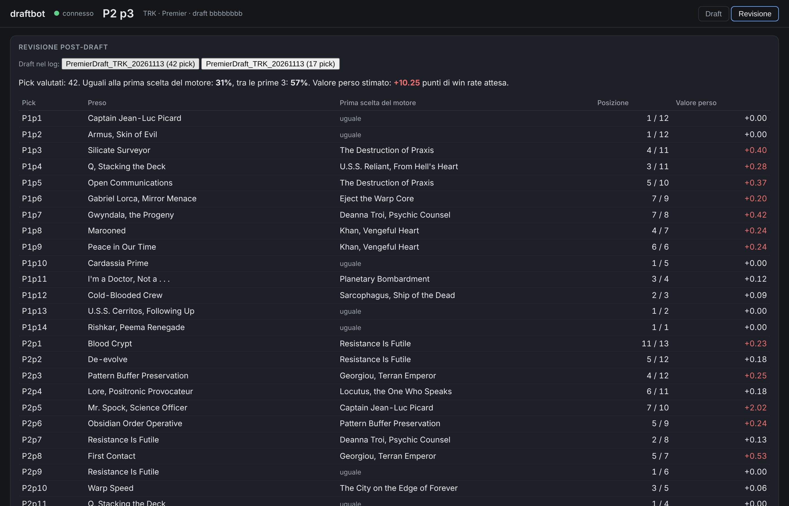

# Fase 8 — UI web locale e revisione post-draft

Data: 2026-11-28.

## Avvio

```bash
pip install -e .[ui]                     # FastAPI e uvicorn (opzionali)
python -m draftbot ui                    # usa il Player.log standard
python -m draftbot ui --log "C:\...\Player.log" --port 8765
```

Poi apri http://127.0.0.1:8765. Il server ascolta solo su 127.0.0.1, quindi non è raggiungibile da
altri computer della rete. Con `--new-only` ignora quanto già scritto nel log.

## Cosa mostra



- **Consigli**: le k opzioni del motore (coppie in Pick Two), ciascuna con:
  - valore in punti di win rate attesa del mazzo finale;
  - parte dovuta al mazzo;
  - valore atteso di ciò che tornerà al giro dopo;
  - distanza dalla prima opzione;
  - temi di sinergia delle carte, solo se misurati per il set (Fase 5).
- **Busta**: carte ordinate per qualità, con colori, costo e probabilità di tornare (wheel, Fase 7).
  Le carte consigliate sono evidenziate.
- **Archetipi probabili**: le coppie di colori più probabili dato il pool.
- **Pool**: le carte prese finora.
- **Mazzi proposti**: a draft finito, le 3 build della Fase 6 con terre e curva.
- **Revisione**: per ogni draft letto dal log, pick per pick: la scelta fatta, la prima scelta del
  motore, la posizione della scelta fatta nella classifica del motore e il valore perso stimato.



Gli screenshot vengono da un log **sintetico** con ID Arena TRK: le carte prese sono a caso, quindi
la revisione mostra molti disaccordi. Per TRK la qualità delle carte viene dal solo prior, perché
non ci sono ancora game data.

## Architettura (`draftbot/ui/`)

- `server.py`: FastAPI.
  - Un thread segue Player.log (`LogTailer`) e passa le righe alla `LiveSession` della Fase 7.
  - Gli eventi (`pick`, `build`, `status`, `error`) vanno a tutti i browser connessi via WebSocket `/ws`.
  - REST: `GET /api/state` (ultimo pick e ultima build, per chi apre la pagina a draft iniziato),
    `GET /api/drafts`, `GET /api/review/{draft_id}`.
  - Un lock protegge il parser condiviso tra il thread del log e le richieste.
- `static/index.html`: una sola pagina, JavaScript senza dipendenze esterne: funziona offline. Si
  riconnette da sola se il server si riavvia.
- `draftbot/engine/review.py`: la revisione, disponibile anche da riga di comando:
  `python -m draftbot review [--log ...] [--draft ID]`.

La revisione è una stima del modello, con i suoi limiti: impegno sui colori troppo precoce nei primi
pick (Fase 4) e sinergie escluse (Fase 5). La pagina lo dice esplicitamente.

## Bug trovato provando la UI

La connessione SQLite della sessione live veniva creata nel thread principale e usata nel thread
che segue il log: SQLite lo vieta e il motore non partiva. I test con TestClient non lo vedevano,
perché lì tutto gira in un solo thread. Ora ogni caricamento del motore apre una connessione propria.

## Test

`tests/test_ui.py` (FastAPI TestClient, motore finto):
- la revisione conta tutti i 42 pick e non dà mai valori persi negativi;
- pagina, `/api/state`, WebSocket (gli eventi arrivano mentre il log viene letto), `/api/drafts`,
  `/api/review` e 404 per un draft inesistente.

Verifica manuale: server avviato su un log sintetico con un draft completo e uno in corso,
screenshot con Playwright, nessun errore JavaScript.

## Limiti

- Niente immagini delle carte: Scryfall le fornisce, ma la UI ora mostra solo i nomi. Aggiungerle è
  semplice (il campo `image_uri` è già nel database), ma vorrebbe dire scaricarle durante il draft.
- La revisione ricalcola tutte le opzioni di ogni pick: in Pick Two richiede alcuni secondi.
- Non verificata su un vero Player.log (vedi Fase 2).
